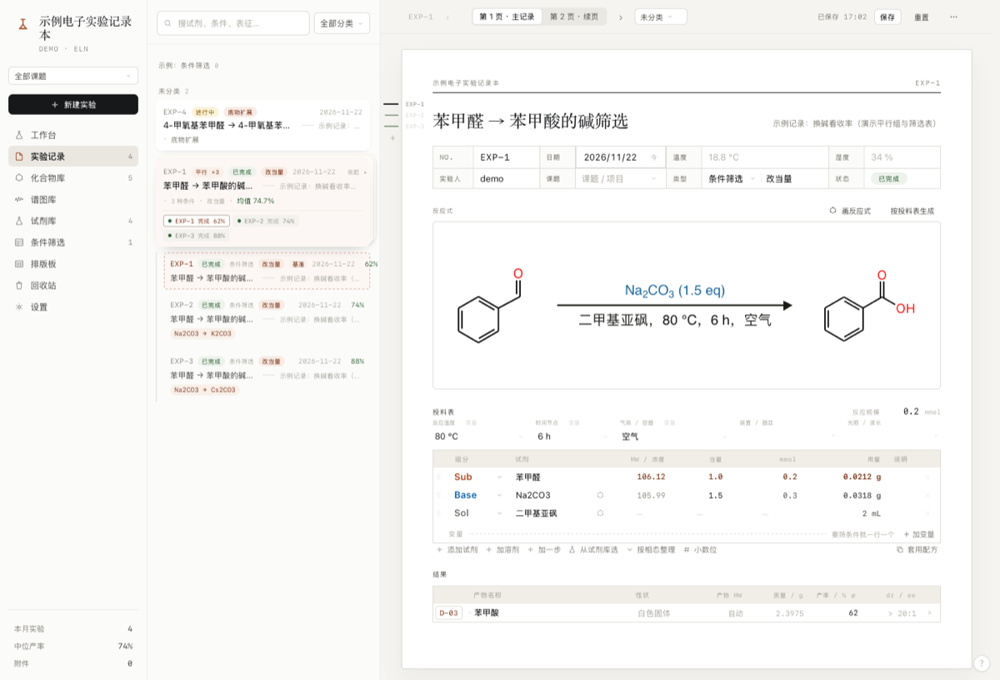
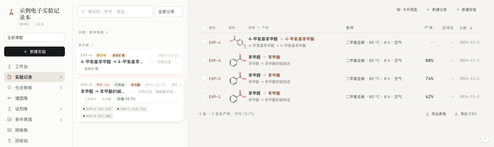
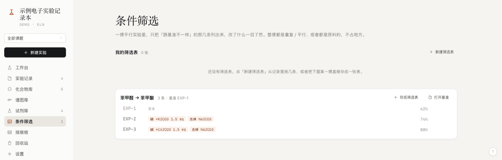
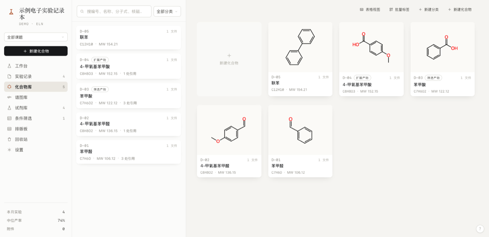

# 方法学实验记录

在线演示：**http://123.56.150.128/** —— 合成示例数据（4 条记录 / 5 个化合物），每天 04:10 恢复初始快照。
示例站可以随意修改，不要放真实记录；源码里不含私人数据。

本机运行的电子实验记录本，一条实验对应两页 A4。当前版本 **1.1**。
单人单机，数据都在本地磁盘上；除可选的 PubChem 查询外不需要联网。

```
双击 start.command      →  打开 http://127.0.0.1:4780
双击 preview.command    →  开发模式（vite :5173）
```

需要 Node ≥ 22（用到内置的 `node:sqlite`）。

---

## 界面

记录页：中栏列当前课题的记录，右边是这条实验的纸面。



实验记录可切表格视图，可按列排序、勾选、导出 CSV / Markdown。



条件筛选：一组只改一个变量的实验，摊成清单，每行写相对基准的改动。



化合物库：结构式、分子式 / MW、来源、引用次数。



图片取自演示数据（`scripts/seed-demo.js` 生成）。

---

## 一条实验有什么

**第 1 页**：抬头（编号 / 日期 / 课题 / 状态 / 温湿度）· 反应式 · 投料表 · 条件 · 结果
**第 2 页**：操作与现象（含照片）· 后处理 · TLC · 讨论与结论
**第 3 页**：文献摘记与文献图（没有内容就不打印）；附件单独一个页签

- **投料表**：填当量或 mmol，质量与体积自动算；组分可选底物 / 试剂 / 碱 / 配体 / 溶剂；合计行给出瓶子与磁子的推荐尺寸
- **结果**：填质量算产率与理论产量；粗产物可标「不计产率」
- **反应式**：按投料表生成（底物 → 产物，试剂与当量在箭头上，溶剂 / 温度 / 时间在下方），结构取化合物库里画的那份，缩写基团（Ts / Bn / Ph）照原样保留；生成结果会缓存，再次打开直接出图。也可以右上角「画反应式」在 Ketcher 里手画
- **图片**：⌘V 粘贴；操作与现象旁边可贴照片，能写图注
- **试剂**：直接打名字，MW / 密度到 PubChem 查，查过的记进本地词典
- **化合物库**：结构式、谱图、TLC、CAS、二维码瓶签
- **平行实验**：复制记录后改一个变量，卡片墙上成组显示
- **导出**：单文件网页（.html，图内联）、压缩包（网页 + 原图 + JSON）、整页长图（.png）、Markdown
- **手机端**：同一 Wi-Fi 下打开局域网地址，可加到主屏；能看记录、拍照上传 TLC / 照片 / 谱图，不能编辑

## 文件都是干什么的

```
ELN/
├── start.command / preview.command   启动（生产 / 开发）
├── package.json     依赖与脚本（dev / build / serve）
├── vite.config.js   构建到 public/（4780 直接发这个目录）
├── index.html       开发入口
│
├── server/          本地服务（node:http，无框架）
│   ├── index.js     全部 REST 路由（实验/化合物/附件/导出/查询…）
│   ├── db.js        SQLite 表结构、编号生成、设置读写
│   ├── export.js    Markdown / CSV 导出
│   ├── qr.js        二维码编码（瓶签用）
│   └── *.swift      三个 macOS 原生能力（详见下）
│
├── src/             前端（Vue 3 + Vite）
│   ├── views/       页面：工作台、记录页、化合物、筛选、设置、回收站
│   ├── components/  记录页各区块（投料表、结果、反应式、TLC、照片…）
│   ├── lib/         纯逻辑：化学式/结构图、拖拽排序、打印版式、导出、查询
│   ├── styles/      纸张版式与样式（含 @media print）
│   ├── store.js     全局状态（bootstrap 一次拉齐）
│   └── router.js    路由（#/e/:id、#/c/:id、#/m 手机端…）
│
├── scripts/         维护脚本
│   ├── backup.js        备份 data/ 快照
│   ├── normalize-labels.py / fit-canvas.py / normalize-style.py  结构图标签与画布归一
│   └── build-ketcher.sh / copy-indigo.sh   重新生成 vendor/ 里的画板
│
├── data/            全部数据（不进 git）
│   ├── eln.db       SQLite：实验、投料、附件记录、化合物…
│   ├── attachments/ 实验附件（谱图、TLC、反应式、照片）
│   └── compounds/   化合物文件（结构式、谱图）
│
├── vendor/          Ketcher 画板与 Indigo WASM（构建产物，不进 git）
└── public/          前端构建产物（进 git，服务直接发它）
```

## 三个 macOS 原生小工具

用到时编译一次，缓存在 `.cache/`。没有 `swiftc` 时对应功能不可用，其余不受影响：

| 文件 | 作用 | 缺了会怎样 |
|---|---|---|
| `server/print.swift` | 用系统 WebKit 把两页 DOM 渲染成 A4 PDF | 只能用「系统打印」 |
| `server/shot.swift` | 整页长图导出（不分页） | 长图导出不可用 |
| `server/ocr.swift` | 本地 Vision 读 TLC / 谱图上的手写数字 | 手动填 |

## 数据与备份

- 数据都在 `data/`（SQLite + 文件）。备份就是拷走它，或用设置页的「下载完整备份 .zip」。
- 定期备份：放进时间机器 / 网盘，或定时跑 `node scripts/backup.js`。
- 数据库是普通 SQLite 文件，任何 SQLite 客户端都能打开。

## 手机端

1. 设置页打开「允许手机 / 局域网访问」，重启服务；
2. 手机连同一个 Wi-Fi，打开 `http://<本机局域网 IP>:4780`（地址在设置页与启动日志里）；
3. Safari「添加到主屏幕」可当 App 用；扫瓶签二维码直接看化合物档案。

## 给别人用（不用 Docker、不用 npm install）

```bash
./scripts/package.sh          # → dist-pkg/eln-<版本>-<平台>.zip（约 20 MB）
```

包里有 `public/`（前端产物）、`server/`、`vendor/`（画板与结构渲染的静态资源）和启动脚本。
对方解压后双击 `start.command`（macOS）/ `start.bat`（Windows）即可，需要装 Node.js 22+；服务端只用 Node 内置模块，不需要 `node_modules`。

- Windows / Linux 上「PDF 生成、长图导出、图片文字识别」三项不可用（依赖 macOS 系统能力），其余功能正常；
- 数据默认在包内 `data/`，换电脑把整个文件夹搬走即可；
- 多人访问见 `CLOUD-DEPLOY.md`。

## 只在本机、只给自己用

- 默认只监听 `127.0.0.1`；打开「允许局域网访问」后，同一 Wi-Fi 的设备都能访问，请只在自己信任的网络里开。
- 没有账号体系，也没有云同步。
- 开发约定、踩过的坑、改动记录见 `AGENTS.md` 与 `HISTORY.md`；云部署见 `CLOUD-DEPLOY.md`。

## 许可

MIT，见 `LICENSE`。
